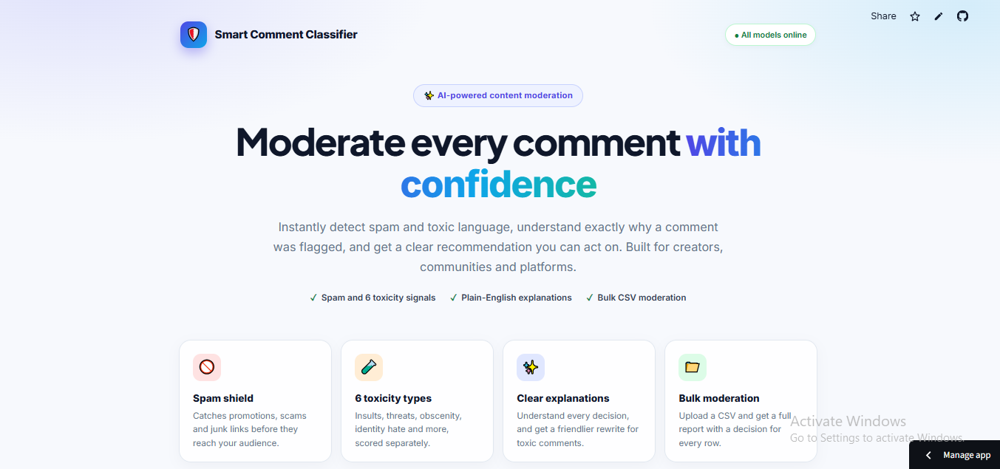
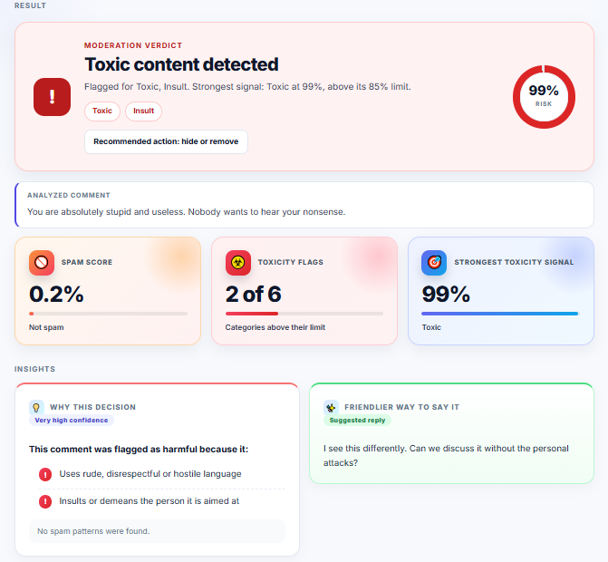
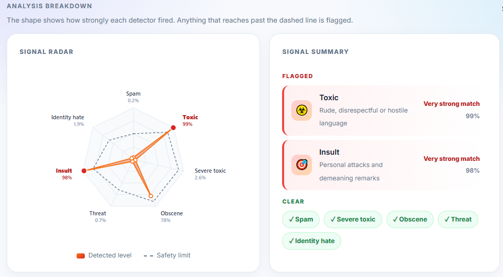
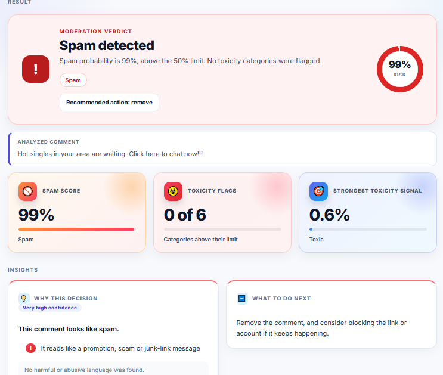
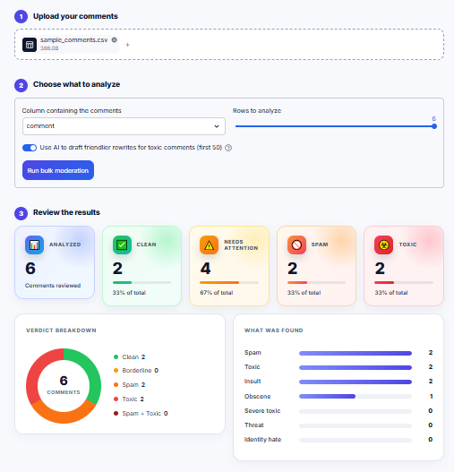
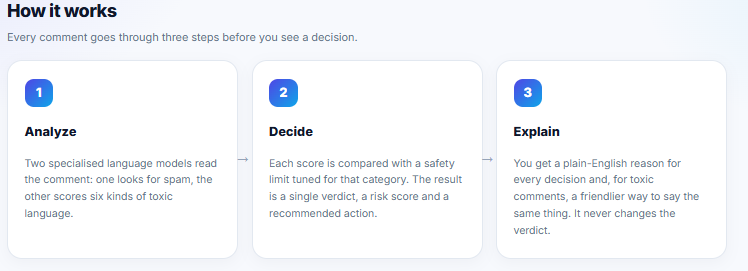
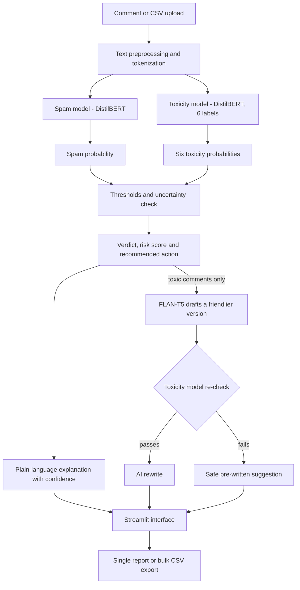

<div align="center">

# 🛡️ Smart Comment Classifier

### AI-assisted comment moderation using Machine Learning, NLP and Generative AI

Detect spam and six types of toxic language, get a clear moderation verdict with a plain-English explanation, and receive a friendlier way to say it, one comment at a time or in bulk from a CSV.

[](https://smart-comment-classifier.streamlit.app/)
[](https://www.python.org/)
[](https://pytorch.org/)
[](https://huggingface.co/siddhu915176)
[](https://streamlit.io/)

**[🌐 Live Application](https://smart-comment-classifier.streamlit.app/)** &nbsp;·&nbsp; **[📂 GitHub Repository](https://github.com/deepak-kumar-da/smart-comment-classifier)** &nbsp;·&nbsp; **[🤗 Models](https://huggingface.co/siddhu915176)**

</div>

---

## 📌 Table of Contents

- [Overview](#-overview)
- [Application Preview](#-application-preview)
- [Problem Statement](#-problem-statement)
- [Key Features](#-key-features)
- [How a Comment Is Processed](#-how-a-comment-is-processed)
- [Sample Outputs](#-sample-outputs)
- [Model Performance](#-model-performance)
- [Dataset and Data Preparation](#-dataset-and-data-preparation)
- [Pretrained and Fine-Tuned Models](#-pretrained-and-fine-tuned-models)
- [Technology Stack](#-technology-stack)
- [Run Locally](#-run-locally)
- [Repository Structure](#-repository-structure)
- [Responsible AI and Limitations](#️-responsible-ai-and-limitations)
- [Future Improvements](#-future-improvements)
- [Author](#-author)

---

## 🔎 Overview

**Smart Comment Classifier** is a moderation assistant for user-generated comments. Two dedicated DistilBERT classifiers decide whether a comment is spam and which kinds of toxicity it contains. Their scores are turned into a single, easy-to-act-on verdict with a risk score, a recommended action, a plain-language explanation and, for toxic comments, a friendlier rewrite.

**Highlights**

- 🚫 **Spam detection** with a fine-tuned DistilBERT classifier.
- ☣️ **Six-label toxicity detection** with per-category tuned decision thresholds.
- ✅ **One clear verdict** (Clean, Borderline, Spam, Toxic or Spam + Toxic) with a risk score and recommended action.
- 💡 **Plain-language explanations** with a confidence level, written directly from the classifier outputs.
- ✨ **Friendlier rewrites for toxic comments**, checked by the toxicity model before they are shown.
- 📡 **Signal radar** showing how strongly each detector fired against its safety limit.
- 📁 **Bulk CSV moderation** with summary charts, filters, a per-comment inspector and CSV export.
- 🤝 Designed as a **decision-support tool**, not an automatic deletion system.

---

## 📸 Application Preview

> Screenshots are stored in the [`screenshots/`](screenshots/) folder.

### Home

<p align="center">
  
</p>

### Single Comment Review: Verdict, Risk Score and Insights

<p align="center">
  
</p>

### Analysis Breakdown: Signal Radar and Summary

<p align="center">
  
</p>

### Spam Detection Example

<p align="center">
  
</p>

### Bulk Moderation

<p align="center">
  
</p>

### How It Works

<p align="center">
  
</p>

---

## 🎯 Problem Statement

Online platforms receive large volumes of comments every day. Some of them are spam, insults, threats or other harmful content. Reviewing every comment by hand is slow and does not scale.

This project builds an intelligent moderation assistant that can:

- Identify unwanted spam comments.
- Detect multiple categories of toxic language.
- Show prediction confidence and a clear recommended action.
- Explain a decision in language a non-technical moderator understands.
- Suggest more respectful wording for harmful comments.
- Process many comments at once through CSV-based batch analysis.

The system is intentionally built to **support** human moderators rather than replace them.

---

## ✨ Key Features

### 1. Spam Detection

A dedicated DistilBERT-based classifier identifies promotional, scam and junk-link content.

- Binary spam classification with a probability score.
- Decision threshold of 50%, with a borderline zone near the limit.

### 2. Multi-Label Toxicity Detection

A separate DistilBERT model scores six categories independently:

| Category | Description |
|---|---|
| Toxic | Generally rude, disrespectful or hostile language |
| Severe Toxic | Extremely aggressive or hateful language |
| Obscene | Profanity and vulgar content |
| Threat | Threats of harm or violence |
| Insult | Personal attacks and demeaning remarks |
| Identity Hate | Hostility toward a group because of who they are |

Each category uses its own **optimized decision threshold** instead of one universal cutoff (see [Model Performance](#-model-performance)).

### 3. Verdict, Risk Score and Recommended Action

Scores from both models are combined into a single decision:

| Verdict | Meaning | Recommended action |
|---|---|---|
| 🟢 Clean | No signal crossed its limit | Approve |
| 🟡 Borderline | Nothing crossed a limit, but a score is very close | Manual review |
| 🟠 Spam | Looks like a promotion, scam or junk link | Remove |
| 🔴 Toxic | One or more toxicity categories were flagged | Hide or remove |
| 🔴 Spam + Toxic | Both spam and toxicity were flagged | Remove |

A **risk score** (0 to 100%) shows how strong the strongest signal is.

### 4. Plain-Language Explanations

Every verdict comes with a short explanation and a confidence level (for example *Very high confidence*). Explanations are generated **directly from the classifier outputs**, so they always agree with the verdict and never contradict it.

### 5. Friendlier Rewrites for Toxic Comments

For toxic comments the app suggests a more respectful way to say the same thing:

1. **FLAN-T5-base** drafts a polite version of the comment.
2. The draft is **re-checked by the toxicity classifier** and rejected if it is still toxic, repetitive, a copy of the original, or unusually long.
3. If the draft fails the check, the app falls back to a **safe, pre-written suggestion** matched to the type of toxicity.

Rewrites are only suggestions and never change the verdict.

### 6. Signal Radar

A radar chart shows how strongly each of the seven detectors fired (spam plus six toxicity categories). A dashed line marks each safety limit, and a signal summary lists what was flagged, what was close to the limit, and what was clear.

### 7. Bulk CSV Moderation

- Upload a CSV and pick the comment column.
- Get a verdict, risk score, recommended action and explanation for every row.
- See summary cards, a verdict breakdown chart and a "what was found" breakdown.
- Filter by verdict, search comments and sort by risk.
- Inspect any single comment in detail.
- Download the **full report** or **flagged comments only** as CSV.
- A sample CSV is available inside the app to try it quickly.

### 8. Quick Examples

Example buttons (Friendly, Toxic, Spam and Random) load a different sample comment each time, so the app can be demonstrated in seconds.

---

## 🏗️ How a Comment Is Processed



---

## 🧪 Sample Outputs

Real results from the deployed application:

| Comment | Verdict | What the models found |
|---|---|---|
| *You are absolutely stupid and useless. Nobody wants to hear your nonsense.* | 🔴 Toxic content detected | Flagged for **Toxic** and **Insult**; spam score 0.2% |
| *WIN a FREE iPhone now!!! Click http://bit.ly/free-prize and claim your reward today* | 🟠 Spam detected | Spam score **99.7%**; no toxicity flagged |
| *What a pathetic idea. Only an idiot would believe this.* | 🔴 Toxic content detected | **Toxic** 99% and **Insult** 97% flagged; **Obscene** (83%) shown as close to its limit |

> Full output files are available in [`sample_data/`](sample_data/): the input `sample_comments.csv` and the generated `moderation_report.csv`.

---

## 🤖 Model Performance

The project uses separate models for spam detection and multi-label toxicity classification.

### Spam Classification

Reported evaluation results of the traditional baselines:

| Model | F1 Score | Spam Precision | Spam Recall |
|---|---:|---:|---:|
| Logistic Regression | 0.95 | 0.98 | 0.92 |
| Support Vector Machine | 0.94 | 0.96 | 0.92 |
| Naive Bayes | 0.93 | 0.93 | 0.92 |

Logistic Regression was the strongest reported baseline. The **deployed application uses a separate fine-tuned DistilBERT spam classifier**; the table above compares the traditional ML baselines only. See the notebooks for the corresponding experiments.

### Toxicity Classification

The fine-tuned DistilBERT model was evaluated with multi-label metrics:

| Metric | Default Thresholds | Optimized Thresholds |
|---|---:|---:|
| Macro F1 | 0.6407 | 0.6557 |
| Micro F1 | 0.7529 | 0.7764 |
| Weighted F1 | 0.7616 | 0.7805 |

Optimizing category-specific thresholds improved every reported metric.

### Optimized Toxicity Thresholds (used in the deployed app)

| Category | Threshold |
|---|---:|
| Toxic | 0.85 |
| Severe Toxic | 0.90 |
| Obscene | 0.90 |
| Threat | 0.65 |
| Insult | 0.80 |
| Identity Hate | 0.60 |


---

## 📚 Dataset and Data Preparation

### Spam Detection

The spam pipeline used spam-labelled comment data, including the SPAMID dataset.
Cleaned SPAMID dataset size: **72,873 rows**.

### Toxicity Detection

The toxicity pipeline used the Jigsaw toxic comment data.
Cleaned Jigsaw dataset size: **159,272 rows**, covering six independently predicted categories.

### Data Preparation Workflow

- Dataset inspection and exploratory data analysis.
- Missing-value handling.
- Duplicate detection and removal.
- Text cleaning and preprocessing.
- Label distribution analysis.
- Train and evaluation split preparation.
- Model evaluation and threshold optimization.

Detailed preprocessing and experiments are in the Jupyter notebooks inside [`notebooks/`](notebooks/).

---

## 🔗 Pretrained and Fine-Tuned Models

| Model | Purpose | Link |
|---|---|---|
| Spam Classifier | Fine-tuned DistilBERT for spam detection | [smart-comment-classifier-spam](https://huggingface.co/siddhu915176/smart-comment-classifier-spam) |
| Toxicity Classifier | Fine-tuned DistilBERT for six toxicity labels | [smart-comment-classifier-toxicity](https://huggingface.co/siddhu915176/smart-comment-classifier-toxicity) |
| Rewrite Assistant | Drafts friendlier rewrites for toxic comments | [google/flan-t5-base](https://huggingface.co/google/flan-t5-base) |

The Streamlit app downloads the public classification models directly from Hugging Face on first use.

---

## 🧰 Technology Stack

| Component | Technology |
|---|---|
| Language | Python |
| Data Processing | Pandas, NumPy |
| Classical ML | Scikit-learn |
| Deep Learning | PyTorch |
| NLP | Hugging Face Transformers |
| Classification Models | DistilBERT |
| Rewrite Assistant | FLAN-T5-base |
| Web Application | Streamlit with custom HTML and CSS |
| Model Hosting | Hugging Face Hub |
| Application Hosting | Streamlit Community Cloud |
| Development Environment | Google Colab |

---

## 🚀 Run Locally

### 1. Clone the repository

```bash
git clone https://github.com/deepak-kumar-da/smart-comment-classifier.git
cd smart-comment-classifier
```

### 2. Create a virtual environment

```bash
python -m venv venv
```

**Windows**
```bash
venv\Scripts\activate
```

**Linux / macOS**
```bash
source venv/bin/activate
```

### 3. Install dependencies

```bash
pip install -r requirements.txt
```

### 4. Launch the application

```bash
streamlit run streamlit_app/app.py
```

The app opens at the local address shown in your terminal.

> An internet connection is required on first use to download the hosted models. Memory requirements depend on the hosting environment; the rewrite assistant (FLAN-T5-base) is loaded only when a toxic comment needs a rewrite.

---

## 📁 Repository Structure

```text
smart-comment-classifier/
│
├── notebooks/                # Data preparation, training and evaluation notebooks
│   └── 00_dataset_research_and_audit.ipynb           # Plots and reports exported from the notebooks
│   ├── spam_confusion_matrix.png
│   ├── toxicity_classification_report.png
│   └── toxicity_threshold_optimization.png
├── streamlit_app/
│   └── app.py                # Streamlit application
│
├── screenshots/              # Application screenshots used in this README
│   ├── 01_home.png
│   ├── 02_toxic_verdict.png
│   ├── 03_signal_radar.png
│   ├── 04_spam_example.png
│   ├── 05_bulk_results.png
│   └── 06_how_it_works.png
│
├── docs/
│   └── evaluation/           # Plots and reports exported from the notebooks
│       ├── spam_confusion_matrix.png
│       ├── toxicity_classification_report.png
│       └── toxicity_threshold_optimization.png
│
├── sample_data/
│   ├── sample_comments.csv   # Example input for bulk moderation
│   └── moderation_report.csv # Report generated from the sample input
│
├── README.md
├── requirements.txt
├── .gitignore
└── LICENSE
```

---

## ⚖️ Responsible AI and Limitations

This project is designed to **assist human moderation, not replace human judgment.**

- Predictions are probabilistic and can produce false positives and false negatives.
- Context, sarcasm, slang and language variation can affect results.
- Toxicity categories can overlap.
- Best results are expected on English text; other languages may be less reliable.
- Comments close to a decision limit are marked **Borderline** and routed to a human.
- Friendlier rewrites are suggestions only. They are checked automatically but may not always be perfect.
- The application does not delete content or penalize users automatically.
- Comments are processed in memory during the session and are not stored by the application.

The system should undergo additional testing, validation and monitoring before any production deployment on a real platform.

---

## 🔮 Future Improvements

- Multilingual support and better handling of sarcasm and implicit abuse.
- Reporting evaluation metrics for the deployed DistilBERT spam model alongside the baselines.
- Advanced model explainability (token-level highlighting).
- Additional domain-specific datasets.
- REST API for integration with external moderation platforms.
- Performance optimization for large-scale inference.
- Human-feedback loop for continuous model improvement.
- RAG-based moderation policy assistant.

---

## 👨‍💻 Author

**Deepak Kumar**

- GitHub: [@deepak-kumar-da](https://github.com/deepak-kumar-da)
- Live Demo: [smart-comment-classifier.streamlit.app](https://smart-comment-classifier.streamlit.app/)

---

<div align="center">

If you find this project useful, consider giving the repository a ⭐

*Built as an applied Machine Learning, NLP and Generative AI project.*

</div>
