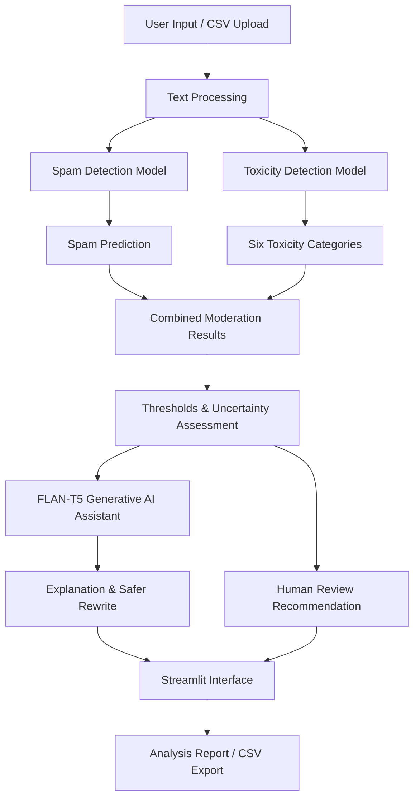

# 🛡️ Smart Comment Classifier

### AI-Powered Comment Moderation | Machine Learning · NLP · Generative AI

<p align="center">
  <a href="https://smart-comment-classifier.streamlit.app/"><strong>🚀 Live Demo</strong></a> ·
  <a href="https://github.com/deepak-kumar-da/smart-comment-classifier"><strong>📂 GitHub Repository</strong></a> ·
  <a href="https://huggingface.co/siddhu915176"><strong>🤗 Hugging Face Models</strong></a>
</p>

<p align="center">
  
  
  
  
  
</p>

**Smart Comment Classifier** is an AI-assisted moderation platform that analyzes user-generated comments to identify spam and potentially harmful language.

It combines dedicated deep-learning classification models with a generative AI assistant to deliver moderation predictions, category-level confidence scores, natural-language explanations, and safer alternative wording.

The platform supports both individual comment analysis and bulk CSV moderation through an interactive Streamlit application.

---

## Table of Contents

- [Overview](#overview)
- [Key Capabilities](#key-capabilities)
- [System Architecture](#system-architecture)
- [Model Performance](#model-performance)
- [Datasets and Processing](#datasets-and-processing)
- [Models and Resources](#models-and-resources)
- [Technology Stack](#technology-stack)
- [Getting Started](#getting-started)
- [Repository Structure](#repository-structure)
- [Responsible AI](#responsible-ai)
- [Future Improvements](#future-improvements)

---

## Overview

Online platforms receive enormous volumes of user-generated content. Identifying spam, harassment, insults, threats, and other harmful language is a challenging moderation task.

Manual moderation can be time-consuming and difficult to scale.

Smart Comment Classifier addresses this problem through a modular AI pipeline that combines:

- **Spam classification:** Identifies potentially unwanted or promotional comments.
- **Toxicity classification:** Detects six categories of potentially harmful language.
- **Generative AI assistance:** Explains predictions and suggests safer alternative wording.
- **Bulk moderation:** Processes multiple comments from CSV files.

The application is designed as a moderation decision-support system. It assists human reviewers rather than automatically deleting comments or penalizing users.

## Key Capabilities

### 1. Spam Detection

A dedicated fine-tuned DistilBERT classifier identifies potentially unwanted or promotional content.

- Binary spam classification.
- Spam probability scores.
- Dedicated spam detection model.
- Separate classification pipeline from toxicity detection.

### 2. Multi-Label Toxicity Detection

A separate fine-tuned DistilBERT model identifies six toxicity categories.

| Category | Description |
|---|---|
| Toxic | Generally harmful or abusive language |
| Severe Toxic | Highly aggressive or abusive language |
| Obscene | Obscene or explicit language |
| Threat | Threatening language |
| Insult | Insulting or demeaning language |
| Identity Hate | Language targeting identity groups |

The model uses category-specific optimized thresholds to account for differences between toxicity labels.

### 3. Generative AI Assistance

Integrated with Google's **FLAN-T5-base**, the application provides:

- Natural-language explanations of moderation results.
- Contextual insights based on classifier predictions.
- Suggested safer rewrites when harmful categories are detected.

**Important:** The generative model assists with explanations and rewriting. The dedicated classification models remain responsible for the actual spam and toxicity predictions.

### 4. Individual Comment Analysis

Users can submit a comment and receive:

- Spam classification and probability.
- Six toxicity category probabilities.
- Detected toxicity categories.
- Uncertainty indicators.
- Human-review recommendations.
- AI-generated explanations and safer rewrites.
- Downloadable analysis results.

### 5. Bulk CSV Moderation

The application supports batch analysis of multiple comments.

Users can:

- Upload a CSV dataset.
- Select the comment/text column.
- Process multiple comments.
- Review individual moderation results.
- Examine summary statistics.
- Export the resulting moderation report.

---

## System Architecture

The application follows a modular architecture with two dedicated classification pipelines and an integrated generative AI assistant.



### Moderation Workflow

1. The user submits a comment or uploads a CSV file.
2. Input text is processed by the application.
3. The spam classifier predicts whether the comment is potentially spam.
4. The toxicity classifier evaluates six independent toxicity categories.
5. Category-specific thresholds are applied to toxicity predictions.
6. The application combines predictions and assesses moderation uncertainty.
7. FLAN-T5 assists with explanations and safer alternative wording.
8. Results are presented through the Streamlit interface.

---

## Model Performance

The project uses dedicated models for spam detection and multi-label toxicity classification.

### Spam Classification — Traditional ML Evaluation

The following traditional machine-learning models were evaluated during experimentation.

| Model | F1 Score | Spam Precision | Spam Recall |
|---|---:|---:|---:|
| Logistic Regression | 0.95 | 0.98 | 0.92 |
| Support Vector Machine | 0.94 | 0.96 | 0.92 |
| Naive Bayes | 0.93 | 0.93 | 0.92 |

Logistic Regression achieved the strongest reported F1 score among these evaluated traditional ML baselines.

**Deployment distinction:** The application uses a separate fine-tuned DistilBERT spam classifier. The table above represents traditional ML experiments, not the deployed DistilBERT model.

### Toxicity Classification — DistilBERT

The fine-tuned DistilBERT model was evaluated using multi-label classification metrics.

| Metric | Default Thresholds | Optimized Thresholds |
|---|---:|---:|
| Macro F1 | 0.6407 | 0.6557 |
| Micro F1 | 0.7529 | 0.7764 |
| Weighted F1 | 0.7616 | 0.7805 |

Optimizing category-specific decision thresholds improved the reported evaluation results across all three metrics.

### Optimized Toxicity Thresholds

| Category | Threshold |
|---|---:|
| Toxic | 0.85 |
| Severe Toxic | 0.90 |
| Obscene | 0.90 |
| Threat | 0.65 |
| Insult | 0.80 |
| Identity Hate | 0.60 |

These thresholds are used by the deployed moderation application.

*Evaluation metrics are based on the reported experimental results. Refer to the project notebooks for the associated training and evaluation workflows.*

---

## Datasets and Processing

The project involved dataset inspection, exploratory analysis, cleaning, preprocessing, and preparation for separate spam and toxicity classification tasks.

### Spam Detection

- Dataset: SPAMID and associated spam-labelled comment data.
- Reported cleaned SPAMID dataset size: **72,873 rows**.

### Toxicity Detection

- Dataset: Jigsaw Toxic Comment Classification.
- Reported cleaned dataset size: **159,272 rows**.
- Six independently predicted toxicity categories.

### Data Preparation Workflow

- Dataset inspection and exploratory data analysis.
- Missing-value handling.
- Duplicate detection and removal.
- Text cleaning and preprocessing.
- Label distribution analysis.
- Training and evaluation dataset preparation.
- Model evaluation and threshold optimization.

Detailed experiments and preprocessing workflows are documented in the `notebooks/` directory.

---

## Models and Resources

The fine-tuned classification models are hosted on Hugging Face Hub.

| Component | Model / Resource |
|---|---|
| Spam Classifier | [Smart Comment Classifier — Spam](https://huggingface.co/siddhu915176/smart-comment-classifier-spam) |
| Toxicity Classifier | [Smart Comment Classifier — Toxicity](https://huggingface.co/siddhu915176/smart-comment-classifier-toxicity) |
| Generative AI | [Google FLAN-T5-base](https://huggingface.co/google/flan-t5-base) |

The Streamlit application downloads the public classification models directly from Hugging Face.

No model weight files need to be committed to the GitHub repository.

---

## Technology Stack

| Layer | Technologies |
|---|---|
| Programming Language | Python |
| Data Processing | Pandas, NumPy |
| Machine Learning | Scikit-learn |
| Deep Learning | PyTorch |
| NLP | Hugging Face Transformers |
| Classification Models | DistilBERT |
| Generative AI | FLAN-T5-base |
| Application Interface | Streamlit |
| Model Hosting | Hugging Face Hub |
| Application Hosting | Streamlit Community Cloud |
| Development Environment | Google Colab |

---

## Getting Started

Follow these steps to run the application locally.

### Prerequisites

- Python 3.10 or later.
- Git.
- Internet connection for downloading hosted models.
- Sufficient memory to load the classification and generative models.

### 1. Clone the Repository

```bash
git clone https://github.com/deepak-kumar-da/smart-comment-classifier.git

cd smart-comment-classifier
```

### 2. Create a Virtual Environment

```bash
python -m venv venv
```

Activate the environment:

**Windows**

```bash
venv\Scripts\activate
```

**Linux / macOS**

```bash
source venv/bin/activate
```

### 3. Install Dependencies

```bash
pip install -r requirements.txt
```

### 4. Run the Application

```bash
streamlit run streamlit_app/app.py
```

The application will be accessible at the local URL displayed in your terminal.

**Note:** An internet connection is required to download the hosted models on first use. Model loading and inference performance depend on available hardware and memory.

---

## Repository Structure

```text
smart-comment-classifier/
│
├── notebooks/
│   ├── Jupyter Notebook Experiments
│   └── Model Training & Evaluation
│
├── streamlit_app/
│   └── app.py
│
├── screenshots/              # Application screenshots (to be added)
│
├── README.md
├── requirements.txt
├── .gitignore
└── LICENSE                   # Include if a license has been added
```

The notebooks directory contains the project's experimentation, preprocessing, training, and evaluation workflows.

---

## Responsible AI

Smart Comment Classifier is designed to assist human moderation, not replace human judgment.

Important limitations and considerations:

- Predictions are probabilistic and may produce false positives or false negatives.
- Context, sarcasm, slang, and language variation can affect classification.
- Toxicity categories may overlap.
- A comment's intent cannot always be determined from text alone.
- Generative AI explanations and rewrites may be imperfect.
- Uncertain or high-impact decisions should be reviewed by a human.
- The application does not automatically delete comments or penalize users.

Additional validation, bias evaluation, monitoring, and domain-specific testing are necessary before deployment in a production moderation environment.

---

## Future Improvements

Potential directions for further development include:

- Improved contextual understanding and multilingual support.
- Better detection of sarcasm and implicit abuse.
- Advanced model explainability.
- Additional language and domain-specific datasets.
- API integration for external moderation platforms.
- Performance optimization for large-scale inference.
- Human-feedback-based model improvement.
- RAG-based moderation knowledge assistance.

---

## Project Information

| Detail | Information |
|---|---|
| Project | Smart Comment Classifier |
| Domain | Machine Learning, NLP & Generative AI |
| Interface | Streamlit |
| Classification Models | Fine-tuned DistilBERT |
| Generative Model | FLAN-T5-base |
| Model Hosting | Hugging Face Hub |
| Application Hosting | Streamlit Community Cloud |

**Developer:** Deepak Kumar

- **GitHub:** [deepak-kumar-da](https://github.com/deepak-kumar-da)
- **Repository:** [smart-comment-classifier](https://github.com/deepak-kumar-da/smart-comment-classifier)
- **Live Application:** [Launch Smart Comment Classifier](https://smart-comment-classifier.streamlit.app/)

---

<p align="center">
  <strong>Built with Machine Learning, NLP, and Generative AI.</strong>
  <br/>
  <sub>An applied AI project exploring intelligent and human-assisted content moderation.</sub>
</p>
