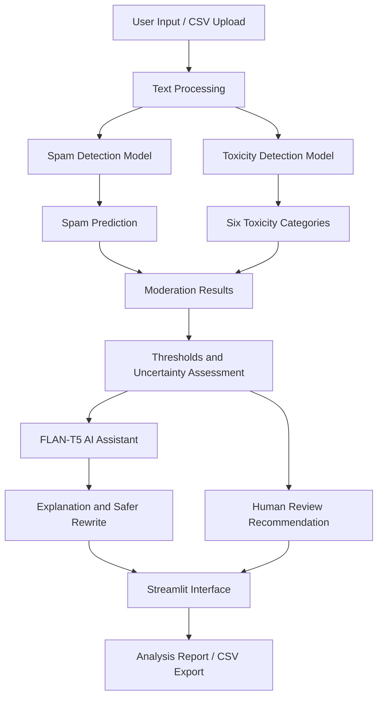

# 🛡️ Smart Comment Classifier
### AI-Powered Comment Moderation using Machine Learning, NLP & Generative AI

[](https://www.python.org/)
[](https://pytorch.org/)
[](https://huggingface.co/)
[](https://streamlit.io/)

**Smart Comment Classifier** is an AI-assisted comment moderation platform designed to identify spam and potentially harmful content in user-generated comments.

The system combines dedicated machine learning models, Natural Language Processing (NLP), and a generative AI assistant to provide moderation predictions, confidence scores, explanations, and safer alternative wording.

🌐 **Live Application:** [ADD YOUR STREAMLIT APP URL]

📂 **GitHub Repository:** [ADD YOUR GITHUB REPOSITORY URL]

---

## 📸 Application Preview

<!-- Add your actual application screenshots inside the screenshots/ folder -->

### Application Interface


### Individual Comment Analysis


### Bulk Moderation


---

## 🎯 Problem Statement

Online platforms receive large volumes of user-generated comments every day. Among these comments are spam messages, harassment, insults, threats, and other forms of harmful content.

Manually reviewing every comment is time-consuming and difficult to scale.

This project aims to build an intelligent moderation assistant that can:

- Identify potentially unwanted spam comments.
- Detect multiple categories of toxic language.
- Provide prediction probabilities and moderation insights.
- Generate understandable explanations using a language model.
- Suggest more respectful alternatives to harmful comments.
- Process multiple comments through CSV-based batch analysis.

The system is designed as a decision-support tool rather than an automatic content-deletion system.

---

## ✨ Key Features

### 1. Spam Detection

A dedicated DistilBERT-based classification model identifies potentially unwanted or promotional content.

- Binary spam classification.
- Spam probability scores.
- Dedicated model trained for spam detection.

### 2. Multi-Label Toxicity Detection

A separate DistilBERT model identifies six toxicity categories:

| Category | Description |
|---|---|
| Toxic | Generally harmful or abusive language |
| Severe Toxic | Highly aggressive or abusive language |
| Obscene | Obscene or explicit language |
| Threat | Threatening language |
| Insult | Insulting or demeaning language |
| Identity Hate | Language targeting identity groups |

The system uses category-specific optimized decision thresholds rather than applying one universal threshold to every category.

### 3. Generative AI Assistance

Integrated with Google's FLAN-T5-base model.

The AI assistant provides:

- Natural-language explanations of moderation results.
- Contextual insights based on classifier predictions.
- Suggested safer rewrites when harmful categories are detected.

The generative model assists with explanations and rewriting. The dedicated classification models remain the source of moderation predictions.

### 4. Individual Comment Analysis

Users can submit a single comment and receive:

- Spam classification.
- Spam probability.
- Six toxicity category probabilities.
- Detected categories.
- Uncertainty indicators.
- Human-review recommendations.
- AI-generated explanation and suggested rewrite.
- Downloadable analysis report.

### 5. Bulk CSV Moderation

The application also supports multiple comments through CSV uploads.

Users can:

- Upload a CSV dataset.
- Select the comment/text column.
- Process multiple comments.
- Review moderation results.
- View summary statistics.
- Export the complete moderation report.

---

## 🏗️ System Architecture

The project follows a modular architecture with two dedicated classification pipelines and an integrated generative AI assistant.



### Technology Stack

| Component | Technology |
|---|---|
| Programming Language | Python |
| Data Processing | Pandas, NumPy |
| Machine Learning | Scikit-learn |
| Deep Learning | PyTorch |
| NLP | Hugging Face Transformers |
| Classification Models | DistilBERT |
| Generative AI | FLAN-T5-base |
| Visualization | Streamlit |
| Model Hosting | Hugging Face Hub |
| Application Hosting | Streamlit Community Cloud |
| Development Environment | Google Colab |

---

## 🤖 Model Performance

The project uses separate models for spam detection and multi-label toxicity classification.

### Spam Classification

Reported evaluation results:

| Model | F1 Score | Spam Precision | Spam Recall |
|---|---:|---:|---:|
| Logistic Regression | 0.95 | 0.98 | 0.92 |
| Support Vector Machine | 0.94 | 0.96 | 0.92 |
| Naive Bayes | 0.93 | 0.93 | 0.92 |

The Logistic Regression model achieved the strongest reported baseline among these evaluated models.

The deployed application uses a separate fine-tuned DistilBERT spam classifier.

### Toxicity Classification

The fine-tuned DistilBERT model was evaluated using multi-label classification metrics.

| Metric | Default Thresholds | Optimized Thresholds |
|---|---:|---:|
| Macro F1 | 0.6407 | 0.6557 |
| Micro F1 | 0.7529 | 0.7764 |
| Weighted F1 | 0.7616 | 0.7805 |

Optimizing category-specific thresholds improved the reported evaluation results.

### Optimized Toxicity Thresholds

| Category | Threshold |
|---|---:|
| Toxic | 0.85 |
| Severe Toxic | 0.90 |
| Obscene | 0.90 |
| Threat | 0.65 |
| Insult | 0.80 |
| Identity Hate | 0.60 |

These thresholds are used by the deployed moderation application.

*Note: The spam comparison table represents evaluated traditional ML models, not the deployed DistilBERT model. Refer to the notebooks for the corresponding experiments and evaluation details.*

---

## 📚 Dataset and Data Preparation

The project involved collecting, inspecting, cleaning, and preparing datasets for separate spam and toxicity classification tasks.

### Spam Detection

The spam classification pipeline incorporated spam-labelled comment data, including the SPAMID dataset.

Reported cleaned SPAMID dataset size: **72,873 rows**.

### Toxicity Detection

The toxicity pipeline used Jigsaw toxicity data.

Reported cleaned Jigsaw dataset size: **159,272 rows**.

The toxicity task covers six independently predicted categories.

### Data Preparation Workflow

- Dataset inspection and exploratory data analysis.
- Missing-value handling.
- Duplicate detection and removal.
- Text cleaning and preprocessing.
- Label distribution analysis.
- Dataset preparation for model training and evaluation.
- Model evaluation and threshold optimization.

For detailed preprocessing and experiments, refer to the Jupyter notebooks in the `notebooks/` directory.

---

## 🔗 Pretrained and Fine-Tuned Models

The fine-tuned classification models are hosted separately on Hugging Face.

| Model | Hugging Face Repository |
|---|---|
| Spam Classifier | [smart-comment-classifier-spam](https://huggingface.co/siddhu915176/smart-comment-classifier-spam) |
| Toxicity Classifier | [smart-comment-classifier-toxicity](https://huggingface.co/siddhu915176/smart-comment-classifier-toxicity) |

**Generative AI Model:** [Google FLAN-T5-base](https://huggingface.co/google/flan-t5-base)

The Streamlit application downloads the public classification models directly from Hugging Face.

---

## 🚀 Run Locally

### 1. Clone the repository

```bash
git clone https://github.com/YOUR_USERNAME/smart-comment-classifier.git

cd smart-comment-classifier
```

### 2. Create a virtual environment

```bash
python -m venv venv
```

Activate it:

**Windows**
```bash
venv\Scripts\activate
```

**Linux / macOS**
```bash
source venv/bin/activate
```

### 3. Install dependencies

```bash
pip install -r requirements.txt
```

### 4. Launch the application

```bash
streamlit run streamlit_app/app.py
```

The application will be available at the local Streamlit address displayed in your terminal.

*The application requires an internet connection to download the hosted models on first use. Hardware and memory requirements depend on the models and hosting environment.*

---

## 📁 Repository Structure

```text
smart-comment-classifier/
│
├── notebooks/
│   ├── [Your Notebook 00]
│   ├── [Your Notebook 01]
│   ├── ...
│   └── [Your Final Notebook]
│
├── streamlit_app/
│   └── app.py
│
├── screenshots/
│   ├── home.png
│   ├── comment_analysis.png
│   └── bulk_moderation.png
│
├── README.md
├── requirements.txt
├── .gitignore
└── LICENSE
```

---

## ⚖️ Responsible AI and Limitations

This project is designed to assist human moderation, not replace human judgment.

Important considerations:

- Predictions are probabilistic and may contain false positives or false negatives.
- Context, sarcasm, slang, and language variation can affect classification.
- Toxicity categories may overlap.
- Generated explanations and rewrites may not always be perfect.
- Uncertain predictions should be reviewed by a human.
- The application does not automatically delete or punish users based on predictions.

The system should undergo additional testing, validation, and monitoring before any production deployment on a real platform.

---

## 🔮 Future Improvements

Potential future development includes:

- Improved contextual understanding and multilingual support.
- Better detection of sarcasm and implicit abuse.
- Advanced model explainability.
- Additional language and domain-specific datasets.
- API integration for external moderation platforms.
- Performance optimization for large-scale inference.
- Human-feedback-based model improvement.
- RAG-based moderation knowledge assistance.

---

## 👨‍💻 Project Information

**Project:** Smart Comment Classifier  
**Domain:** Machine Learning | NLP | Generative AI  
**Application:** Streamlit  
**Model Hosting:** Hugging Face Hub

**Developer:** YOUR NAME

**GitHub:** [YOUR GITHUB PROFILE]

**Live Demo:** [YOUR STREAMLIT APP URL]

---

### If you find this project interesting

Feel free to explore the notebooks, inspect the model repositories, and try the live application.

⭐ If you find the project useful, consider giving the repository a star.

---

*Built as an applied Machine Learning, NLP, and Generative AI project.*
